# Task API

A Django REST Framework API where you can type a task in plain English, for example
*"Remind me to pay rent on the 1st of every month"*, and get a structured task back.

Features:

- CRUD for tasks with strict validation and **one consistent error shape** for every error
- **Natural-language creation** (`POST /api/tasks/from-text/`) behind a swappable `parse_task_text()` function
  (rule-based now, optional LLM via `TASK_PARSER=llm`)
- **Subtasks** and automatic **breakdown** of a task into subtasks (cascade delete)
- **Idempotent creation** with an optional `Idempotency-Key` header
- **Filtering, search, ordering and pagination** that all work together in one request
- 47 automated tests, a Postman collection (60 requests / 111 assertions) and a hand-written `openapi.yaml`

## Project layout

```
config/                  Django project (settings, root urls)
tasks/
  models.py              Task model (self-referencing parent FK, related_name="subtasks")
  serializers.py         TaskSerializer + strict field validation
  views.py               TaskViewSet (CRUD, from-text, subtasks, breakdown)
  ai.py                  parse_task_text() and break_down_task() - the swappable "AI" layer
  errors.py              error_response() helpers + DRF exception handler
  idempotency.py         In-memory Idempotency-Key store (@idempotent decorator)
  filters.py             django-filter FilterSet + priority-aware ordering
  pagination.py          Page-number pagination (page, page_size)
  tests.py               Automated tests
postman/TaskAPI.postman_collection.json
openapi.yaml
docker-compose.yml       Postgres 16
```

## Setup

Requirements: Python 3.12+ and PostgreSQL 16 - either Docker Desktop (step 3) or a local Postgres install
(see [Postgres without Docker](#postgres-without-docker)).

```bash
# 1. Virtual environment and dependencies
python -m venv .venv
# Windows (PowerShell): .venv\Scripts\Activate.ps1   |   macOS/Linux: source .venv/bin/activate
pip install -r requirements.txt

# 2. Configuration - copy the template and set your own values
cp .env.example .env          # Windows: copy .env.example .env
#   edit .env -> set POSTGRES_PASSWORD and DJANGO_SECRET_KEY

# 3. Postgres in Docker (reads POSTGRES_* from .env)
docker compose up -d

# 4. Database schema
python manage.py migrate

# 5. Run the server
python manage.py runserver
```

The API is now at <http://127.0.0.1:8000/api/tasks/>.

Connect your DB client (DBeaver, pgAdmin, TablePlus, pgweb...) to `localhost:5432`, database `taskapi`,
user `taskapi`, password = the `POSTGRES_PASSWORD` you put in `.env`. The table is `tasks_task`.

### Postgres without Docker

If Docker is not available, the official PostgreSQL zip binaries run without installation or admin rights
(this is how the screenshots below were produced, on Windows):

```bash
# download postgresql-16.x-windows-x64-binaries.zip from enterprisedb.com and extract it to .tools/pgsql
.tools/pgsql/bin/initdb -D .tools/pgdata -U taskapi -W -A scram-sha-256 -E UTF8   # enter POSTGRES_PASSWORD
.tools/pgsql/bin/pg_ctl -D .tools/pgdata -l .tools/pg.log -o "-p 5432 -h 127.0.0.1" start
.tools/pgsql/bin/createdb -h 127.0.0.1 -U taskapi taskapi
# stop later with: .tools/pgsql/bin/pg_ctl -D .tools/pgdata stop
```

`.tools/` is git-ignored. [pgweb](https://github.com/sosedoff/pgweb) (single binary, browser UI) works as the DB client.

Settings are read from environment variables; `config/settings.py` also loads a local `.env` file if present.
`.env` is git-ignored - never commit it.

| Variable | Default | Purpose |
| --- | --- | --- |
| `DJANGO_SECRET_KEY` | random per start | Django secret key |
| `DJANGO_DEBUG` | `0` | `1` enables debug mode (local only) |
| `DJANGO_ALLOWED_HOSTS` | `localhost,127.0.0.1` | Comma-separated host list |
| `POSTGRES_DB` / `POSTGRES_USER` / `POSTGRES_PASSWORD` / `POSTGRES_HOST` / `POSTGRES_PORT` | `taskapi` / `taskapi` / - / `localhost` / `5432` | Database connection |
| `DB_ENGINE` | `postgres` | Set to `sqlite` to run without Docker (quick local testing only) |
| `TASK_PARSER` | `rules` | `rules` = offline rule-based parser, `llm` = OpenAI-compatible LLM |
| `LLM_API_KEY` | - | Required only when `TASK_PARSER=llm` |
| `LLM_API_URL` / `LLM_MODEL` | OpenAI chat completions / `gpt-4o-mini` | LLM endpoint and model |

### Optional: using a real LLM

```bash
# in .env (never commit this file)
TASK_PARSER=llm
LLM_API_KEY=<your key>
```

`settings.py` reads the key with `os.environ.get("LLM_API_KEY")`. If `TASK_PARSER=llm` and the key is
missing, `/from-text/` returns **503** in the standard error shape instead of crashing.

### Running the tests

```bash
python manage.py test tasks                    # uses Postgres (needs CREATEDB, the Docker user has it)
DB_ENGINE=sqlite python manage.py test tasks   # no Docker needed
```

Postman / Newman: import `postman/TaskAPI.postman_collection.json` (variable `baseUrl` defaults to
`http://127.0.0.1:8000`) and run the folders top to bottom, or from the CLI:

```bash
npx newman run postman/TaskAPI.postman_collection.json
```

## Data model

| Field | Type | Rules |
| --- | --- | --- |
| `id` | integer | read-only |
| `title` | string (max 200) | required, must not be empty or whitespace, must be a string |
| `description` | text | required, must not be empty, must be a string |
| `completed` | boolean | JSON `true`/`false` only (`"yes"`, `"true"`, `1` are rejected), default `false` |
| `due_date` | date or null | real calendar date in `YYYY-MM-DD` (`2026-02-30` is rejected) |
| `priority` | string | one of `low`, `medium`, `high`, default `medium` |
| `recurrence` | string or null | one of `daily`, `weekly`, `monthly`, `yearly` |
| `parent` | integer or null | read-only; set only through the subtask endpoints. `on_delete=CASCADE`, `related_name="subtasks"` |
| `created_at`, `updated_at` | datetime | read-only |

## Error format

Every error (400, 404, 405, 422, 502, 503, ...) has exactly this shape. `code` and `message` are always strings:

```json
{
  "error": {
    "code": "VALIDATION_ERROR",
    "message": "Validation failed",
    "details": [{ "field": "title", "issue": "must not be empty" }]
  }
}
```

| Status | `code` | When |
| --- | --- | --- |
| 400 | `VALIDATION_ERROR` | Invalid body, query parameter or `Idempotency-Key` |
| 400 | `MALFORMED_REQUEST` | Body is not valid JSON |
| 400 | `SUBTASK_NESTING_NOT_ALLOWED` | Adding subtasks to / breaking down a task that is itself a subtask |
| 404 | `NOT_FOUND` | Unknown task id or page out of range |
| 405 | `METHOD_NOT_ALLOWED` | e.g. `DELETE /api/tasks/` |
| 422 | `IDEMPOTENCY_KEY_REUSED` | Same `Idempotency-Key` sent with a different body |
| 502 | `INVALID_PARSER_OUTPUT` / `INVALID_BREAKDOWN_OUTPUT` | Parser/breakdown returned data that failed validation - nothing saved |
| 502 | `PARSER_ERROR` / `BREAKDOWN_ERROR` | Parser/breakdown raised an exception - nothing saved |
| 503 | `PARSER_UNAVAILABLE` | `TASK_PARSER=llm` but `LLM_API_KEY` is not set |

How it is built: `tasks/errors.py` has `error_response(code, message, details, status)` and
`errors_to_details(serializer.errors)`. `TaskViewSet` overrides `create`, `update`, `retrieve` and `destroy`,
calls `serializer.is_valid()` itself and catches the missing-object case. A custom DRF `EXCEPTION_HANDLER`
is a safety net for errors raised outside those methods (bad JSON, bad filter values, invalid page, 405).

## Endpoints

| Method | Path | Description |
| --- | --- | --- |
| GET | `/api/tasks/` | List tasks (filter, search, order, paginate) |
| POST | `/api/tasks/` | Create a task (supports `Idempotency-Key`) |
| GET | `/api/tasks/{id}/` | Retrieve a task |
| PUT | `/api/tasks/{id}/` | Replace a task |
| PATCH | `/api/tasks/{id}/` | Partially update a task |
| DELETE | `/api/tasks/{id}/` | Delete a task and its subtasks |
| POST | `/api/tasks/from-text/` | Create a task from plain English (supports `Idempotency-Key`) |
| GET | `/api/tasks/{id}/subtasks/` | List subtasks |
| POST | `/api/tasks/{id}/subtasks/` | Create one subtask |
| POST | `/api/tasks/{id}/breakdown/` | Generate subtasks from the task (supports `Idempotency-Key`) |

All examples below are real responses from the running server.

### Create a task

```bash
curl -X POST http://127.0.0.1:8000/api/tasks/ -H "Content-Type: application/json" \
  -d '{"title":"Buy groceries","description":"Milk and eggs","due_date":"2026-12-01","priority":"high"}'
```

`201 Created`

```json
{
  "id": 16,
  "title": "Buy groceries",
  "description": "Milk and eggs",
  "completed": false,
  "due_date": "2026-12-01",
  "priority": "high",
  "recurrence": null,
  "parent": null,
  "created_at": "2026-11-27T13:33:22.398905Z",
  "updated_at": "2026-11-27T13:33:22.398905Z"
}
```

### Validation error

```bash
curl -X POST http://127.0.0.1:8000/api/tasks/ -H "Content-Type: application/json" \
  -d '{"title":"","description":"x","completed":"yes","due_date":"2026-02-30","priority":"urgent"}'
```

`400 Bad Request`

```json
{
  "error": {
    "code": "VALIDATION_ERROR",
    "message": "Validation failed",
    "details": [
      { "field": "title", "issue": "must not be empty" },
      { "field": "completed", "issue": "must be a boolean" },
      { "field": "due_date", "issue": "must be a valid date in YYYY-MM-DD format" },
      { "field": "priority", "issue": "must be one of low, medium, high" }
    ]
  }
}
```

### List / filter / search / order / paginate

```bash
curl "http://127.0.0.1:8000/api/tasks/?completed=false&is_subtask=false&search=pay&ordering=-priority,due_date&page=1&page_size=5"
```

`200 OK`

```json
{
  "count": 2,
  "next": null,
  "previous": null,
  "results": [
    {
      "id": 3,
      "title": "Pay electricity bill",
      "description": "Urgent: pay electricity bill by next friday",
      "completed": false,
      "due_date": "2026-12-04",
      "priority": "high",
      "recurrence": null,
      "parent": null,
      "created_at": "2026-11-27T13:35:43.683575Z",
      "updated_at": "2026-11-27T13:35:43.683575Z"
    },
    {
      "id": 2,
      "title": "Pay rent",
      "description": "Remind me to pay rent on the 1st of every month",
      "completed": false,
      "due_date": "2026-12-01",
      "priority": "medium",
      "recurrence": "monthly",
      "parent": null,
      "created_at": "2026-11-27T13:35:43.520270Z",
      "updated_at": "2026-11-27T13:35:43.520270Z"
    }
  ]
}
```

| Query parameter | Example | Meaning |
| --- | --- | --- |
| `completed` | `true` | Exact match |
| `priority` | `high` | Exact match (invalid value -> 400) |
| `recurrence` | `monthly` | Exact match |
| `due_date`, `due_after`, `due_before` | `2026-12-01` | Exact / `>=` / `<=` |
| `parent` | `5` | Subtasks of task 5 |
| `is_subtask` | `false` | `false` = top-level only, `true` = subtasks only |
| `search` | `rent` | Case-insensitive search in title and description |
| `ordering` | `-priority,due_date` | `due_date`, `priority` (low < medium < high), `created_at`, `updated_at`, `title`; `-` = descending |
| `page`, `page_size` | `2`, `20` | Default page size 10, max 100. Page out of range -> 404 |

### Retrieve / update / delete

```bash
curl http://127.0.0.1:8000/api/tasks/16/
curl -X PUT   http://127.0.0.1:8000/api/tasks/16/ -H "Content-Type: application/json" -d '{"title":"Buy food","description":"Milk"}'
curl -X PATCH http://127.0.0.1:8000/api/tasks/16/ -H "Content-Type: application/json" -d '{"completed":true}'
curl -X DELETE http://127.0.0.1:8000/api/tasks/16/      # 204 No Content, subtasks are deleted too
```

Unknown id -> `404 Not Found`

```json
{ "error": { "code": "NOT_FOUND", "message": "Task not found", "details": [] } }
```

### Natural-language creation (AI endpoint)

```bash
curl -X POST http://127.0.0.1:8000/api/tasks/from-text/ -H "Content-Type: application/json" \
  -d '{"text":"Remind me to pay rent on the 1st of every month"}'
```

`201 Created`

```json
{
  "id": 17,
  "title": "Pay rent",
  "description": "Remind me to pay rent on the 1st of every month",
  "completed": false,
  "due_date": "2026-12-01",
  "priority": "medium",
  "recurrence": "monthly",
  "parent": null,
  "created_at": "2026-11-27T13:33:22.910644Z",
  "updated_at": "2026-11-27T13:33:22.910644Z"
}
```

The parser output is treated as untrusted and validated with `TaskSerializer`. Text that produces an
invalid task (here: `"tomorrow"` has no title) returns `502 Bad Gateway` and nothing is saved:

```json
{
  "error": {
    "code": "INVALID_PARSER_OUTPUT",
    "message": "The task parser returned invalid data",
    "details": [{ "field": "title", "issue": "must not be empty" }]
  }
}
```

Phrases understood by the rule-based parser:

| Kind | Examples |
| --- | --- |
| Lead-in removed | "remind me to", "don't forget to", "I need to", "please" |
| Relative dates | "today", "tonight", "tomorrow", "day after tomorrow", "in 3 days", "in 2 weeks", "next week" |
| Weekdays | "friday", "on monday", "next friday" |
| Day of month | "on the 1st", "the 15th", "31st" (clamped to the last day of short months) |
| Calendar dates | "15 march", "March 15th", "2026-12-05" |
| Recurrence | "daily" / "every day", "weekly" / "every week" / "every monday", "monthly" / "every month", "yearly" / "annually" |
| Priority | "urgent", "asap", "important", "high priority" -> `high`; "low priority" -> `low` |

#### Swappable parser contract

`tasks/ai.py`:

```python
def parse_task_text(text: str, today: datetime.date) -> dict:
    """Returns:
    {
        "title": str,                    # short imperative title
        "description": str,              # original text
        "due_date": "YYYY-MM-DD" | None,
        "recurrence": "daily" | "weekly" | "monthly" | "yearly" | None,
        "priority": "low" | "medium" | "high",
    }
    May raise ai.ParserUnavailable (-> 503) or any other exception (-> 502).
    """
```

The view only depends on this signature, so the rule-based version can be swapped for an LLM call without
touching the view. `TASK_PARSER=llm` already switches to an OpenAI-compatible chat-completions call that asks
the model for JSON with exactly these keys; the result goes through the same validation.

### Subtasks

```bash
curl -X POST http://127.0.0.1:8000/api/tasks/4/subtasks/ -H "Content-Type: application/json" \
  -d '{"title":"Compare hotel prices","description":"Booking sites"}'
```

`201 Created`

```json
{
  "id": 5,
  "title": "Compare hotel prices",
  "description": "Booking sites",
  "completed": false,
  "due_date": null,
  "priority": "medium",
  "recurrence": null,
  "parent": 4,
  "created_at": "2026-11-27T13:35:44.339280Z",
  "updated_at": "2026-11-27T13:35:44.339280Z"
}
```

`GET /api/tasks/4/subtasks/` returns a JSON array of that task's subtasks.

A subtask cannot have subtasks -> `400 Bad Request`:

```json
{
  "error": {
    "code": "SUBTASK_NESTING_NOT_ALLOWED",
    "message": "A subtask cannot have its own subtasks",
    "details": [{ "field": "parent", "issue": "task is already a subtask" }]
  }
}
```

### Breakdown (AI endpoint)

`break_down_task(task) -> list[dict]` splits the title on commas, `;`, "and", "then". If that gives fewer
than two parts it uses a *Plan / Do / Review* template. Subtasks inherit the parent's priority and due date.
Every item is validated first; if **any** item is invalid, **none** are saved (502).

```bash
curl -X POST http://127.0.0.1:8000/api/tasks/4/breakdown/      # task 4 = "Plan trip and book hotel"
```

`201 Created`

```json
[
  {
    "id": 6,
    "title": "Plan trip",
    "description": "Subtask of: Plan trip and book hotel",
    "completed": false,
    "due_date": null,
    "priority": "medium",
    "recurrence": null,
    "parent": 4,
    "created_at": "2026-11-27T13:35:44.713108Z",
    "updated_at": "2026-11-27T13:35:44.713108Z"
  },
  {
    "id": 7,
    "title": "Book hotel",
    "description": "Subtask of: Plan trip and book hotel",
    "completed": false,
    "due_date": null,
    "priority": "medium",
    "recurrence": null,
    "parent": 4,
    "created_at": "2026-11-27T13:35:44.714110Z",
    "updated_at": "2026-11-27T13:35:44.714110Z"
  }
]
```

### Idempotent creation

`POST /api/tasks/`, `/api/tasks/from-text/` and `/api/tasks/{id}/breakdown/` accept an optional
`Idempotency-Key` header (1-255 characters).

```bash
curl -X POST http://127.0.0.1:8000/api/tasks/ -H "Content-Type: application/json" \
  -H "Idempotency-Key: abc-123" -d '{"title":"A","description":"B"}'     # 201, creates the task
curl -X POST http://127.0.0.1:8000/api/tasks/ -H "Content-Type: application/json" \
  -H "Idempotency-Key: abc-123" -d '{"title":"A","description":"B"}'     # 201, same body, header Idempotent-Replayed: true
curl -X POST http://127.0.0.1:8000/api/tasks/ -H "Content-Type: application/json" \
  -H "Idempotency-Key: abc-123" -d '{"title":"C","description":"B"}'     # 422
```

```json
{
  "error": {
    "code": "IDEMPOTENCY_KEY_REUSED",
    "message": "Idempotency-Key was already used with a different request body",
    "details": [{ "field": "Idempotency-Key", "issue": "reused with a different request" }]
  }
}
```

- Same key + same body -> the stored response is returned. Nothing is created and the parser is not called again.
- Same key + different body (or a different endpoint) -> 422.
- Only successful (2xx) responses are stored, so a client can fix bad input and retry with the same key.
- Store: module-level dict `{key: {"body": ..., "response": ...}}` guarded by a lock. It is per-process and
  cleared on restart; production would use Redis or a DB table.

Proof in the DB client: after sending the same request twice, run
`SELECT id, title FROM tasks_task WHERE title = 'A';` -> exactly one row.

## Testing: AI checklist and what it missed

I asked an AI assistant for a test checklist and Postman requests. Its first version covered the happy paths:
create / list / retrieve / update / delete, an empty title, an invalid priority, from-text with "tomorrow",
creating a subtask, breakdown, sending an idempotency key twice, and one filter and one search.

Reviewing it against the requirements, it **missed**:

| Missing case | What I added |
| --- | --- |
| Impossible dates (`2026-02-30`, `2026-13-01`) and wrong formats (`15-12-2026`, datetimes) | Requests + tests; strict `YYYY-MM-DD` input format |
| `completed: "yes"` / `"true"` / `1` - DRF accepts these by default | `StrictBooleanField` that only accepts JSON booleans |
| Whitespace-only title, missing fields, `title: 123` - DRF turns numbers into strings | `StrictCharField`, explicit messages |
| Unknown ids on GET/PUT/PATCH/DELETE and non-numeric ids | 404 checks for every method |
| Malformed JSON, JSON array body, `DELETE /api/tasks/` | Global exception handler so these also use the error shape |
| Same idempotency key with a **different** body | 422 `IDEMPOTENCY_KEY_REUSED` |
| Failed request must not be stored under the key | Retry with fixed body + same key -> 201 |
| Replay must not call the parser again / must not duplicate breakdown subtasks | `mock.patch(..., wraps=...)` call-count test; breakdown replay test |
| Bad parser output: empty title, `title: 123`, bad date/priority, non-dict, `None`, exception | 502 tests that also assert no row was saved |
| Subtask of a subtask (create and breakdown) | 400 `SUBTASK_NESTING_NOT_ALLOWED` |
| Breakdown where one item is invalid | 502 and zero subtasks saved (all-or-nothing) |
| Cascade delete | Delete parent -> subtask returns 404 / table empty |
| Invalid filter values and out-of-range page | 400 / 404 in the error shape |
| Filters + search + ordering + pagination in **one** request | "Everything combined" request and test |
| `ordering=priority` sorted alphabetically (high < low < medium) | Priority rank annotation so ordering is low < medium < high |

**Simulating bad model output without an LLM:** temporarily change `parse_task_text` in `tasks/ai.py` to
`return {"title": "", "description": "x"}` and call `/from-text/` -> `502 INVALID_PARSER_OUTPUT` and no new
row in `tasks_task` (see screenshots 11 and 12). The same check is automated in
`FromTextTests.test_parser_returning_empty_title_is_502_and_saves_nothing`.

**Debugging:** set a breakpoint in `TaskViewSet.from_text` (after `parse_task_text` returns) and in
`TaskViewSet.breakdown` (after `break_down_task` returns), run `manage.py runserver --noreload` under the
VS Code / PyCharm debugger (or `python -m pdb`) and inspect `parsed` / `items` before validation (screenshot 13).

## Screenshots

All captured against the running API with the Postgres backend. DB views are from the pgweb DB client.

### Idempotency: same request twice -> one row

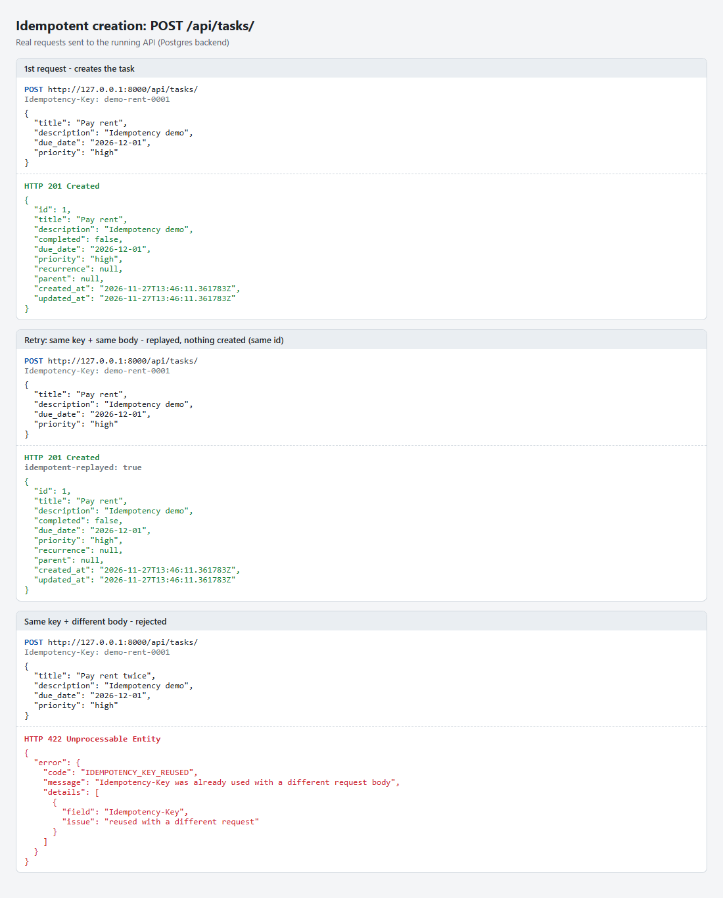
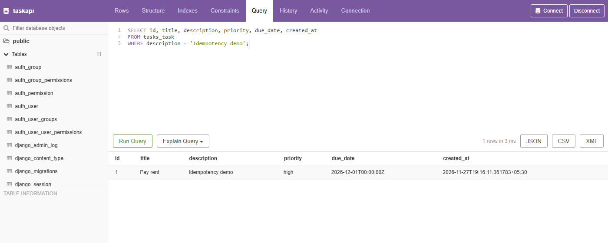

### Natural-language creation with an idempotent retry

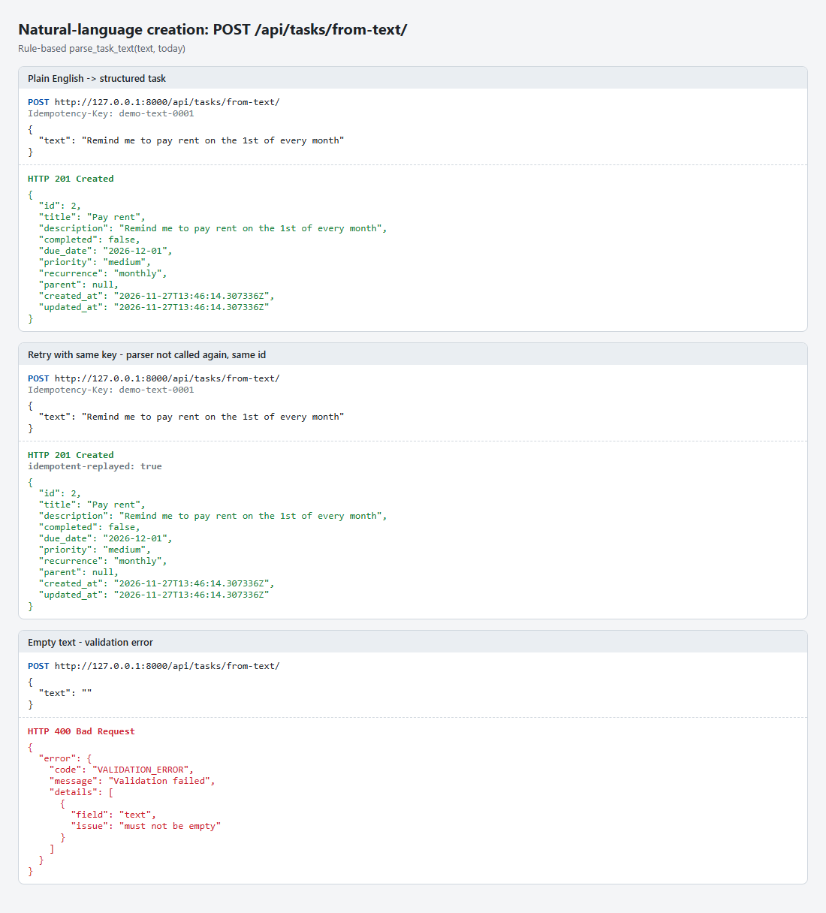
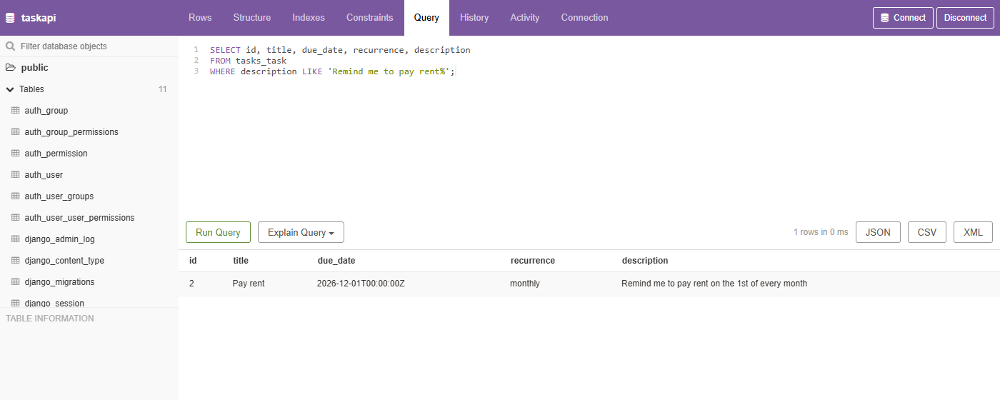

### Subtasks, breakdown and cascade delete

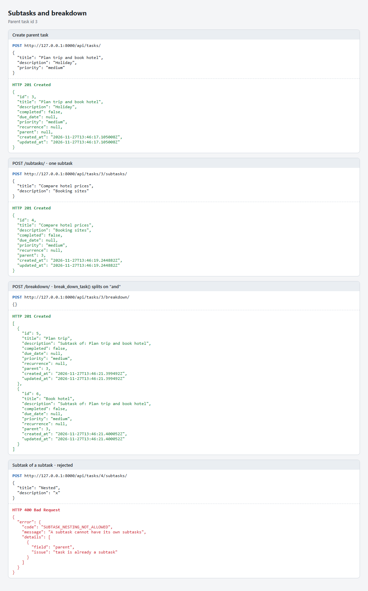
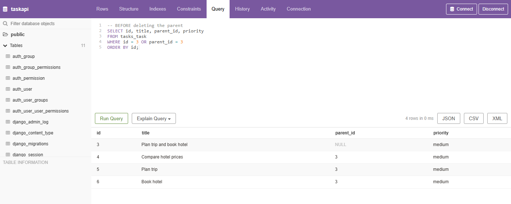
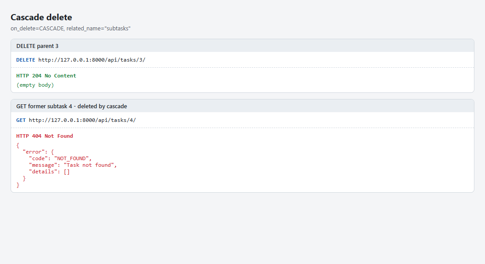
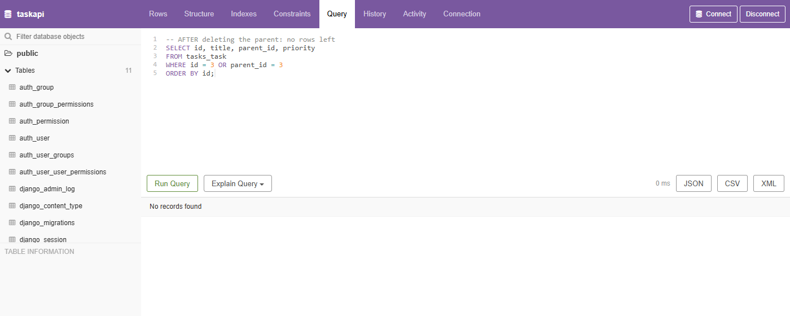

### Validation errors

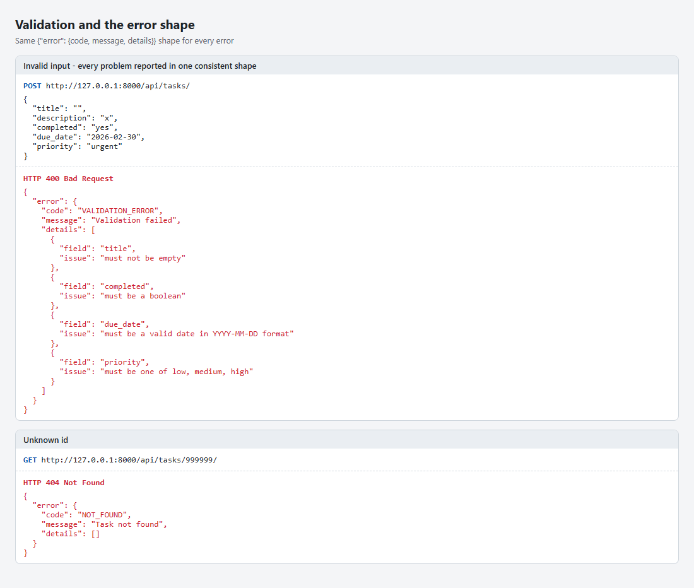

### Filtering + search + ordering + pagination in one request

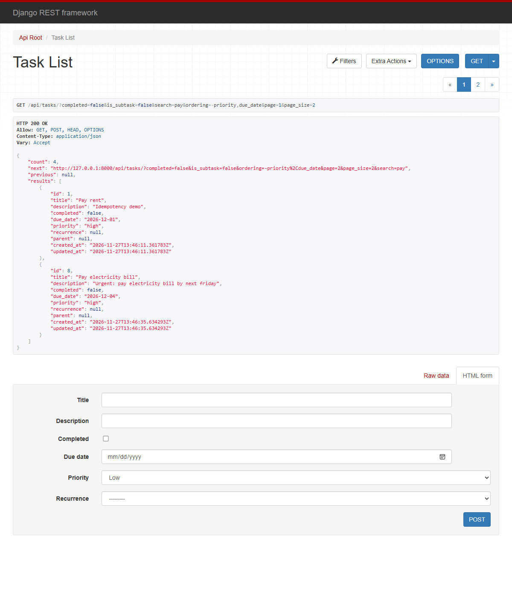

### Simulated bad model output (parse_task_text temporarily returns an empty title)

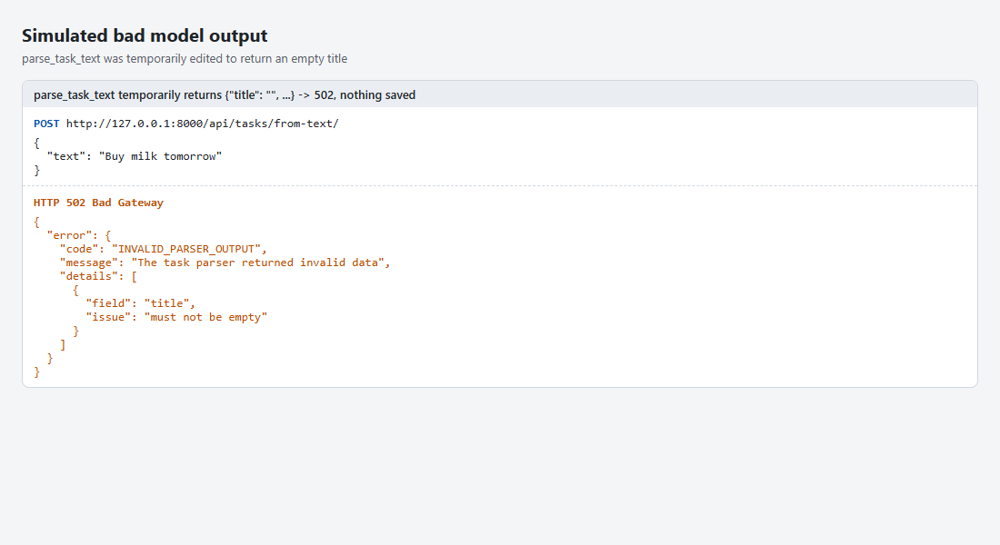
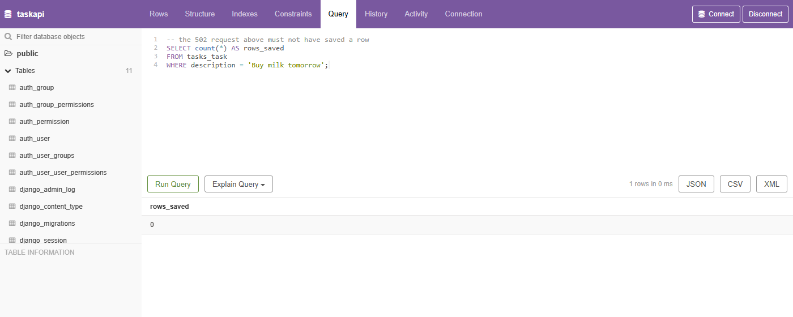

### Breakpoints in the parser and breakdown

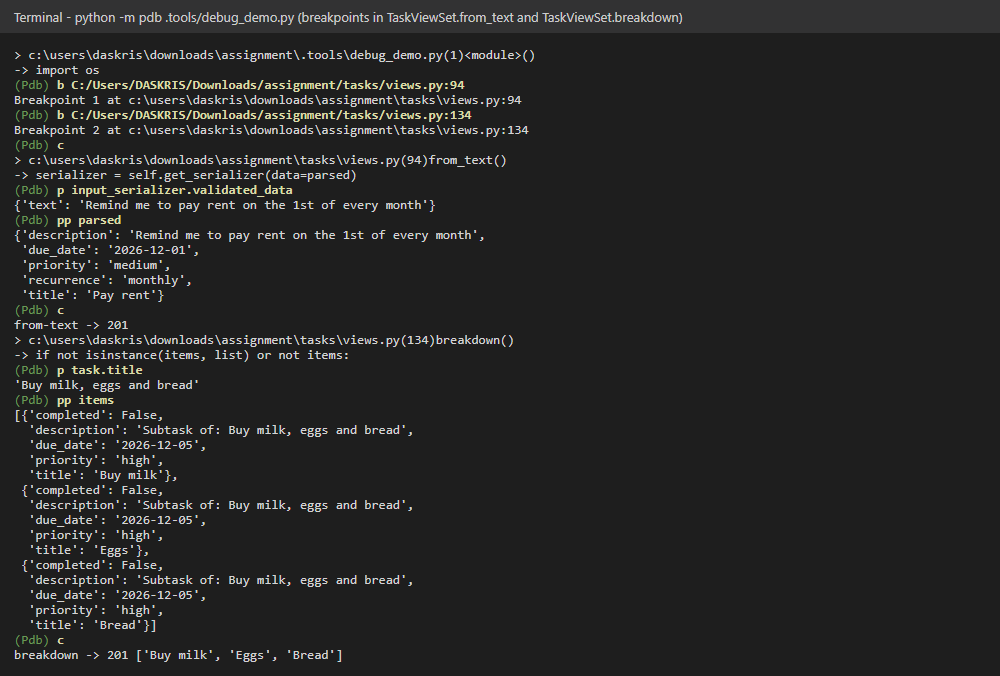

## Documentation

- `openapi.yaml` - hand-written OpenAPI 3.0 description of every endpoint and the error schema
  (open it in <https://editor.swagger.io> to browse).
- `postman/TaskAPI.postman_collection.json` - the full request collection with assertions.
